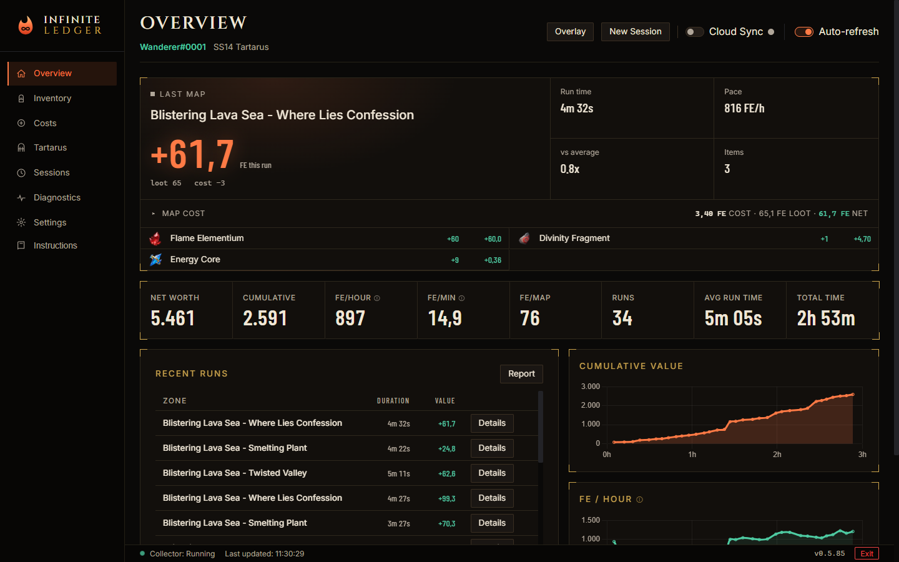
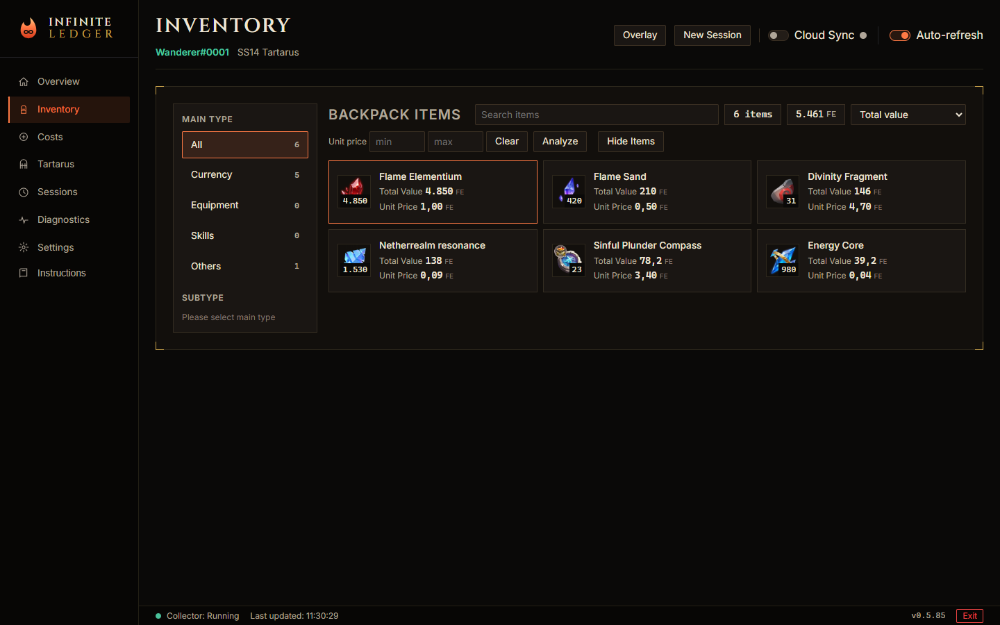
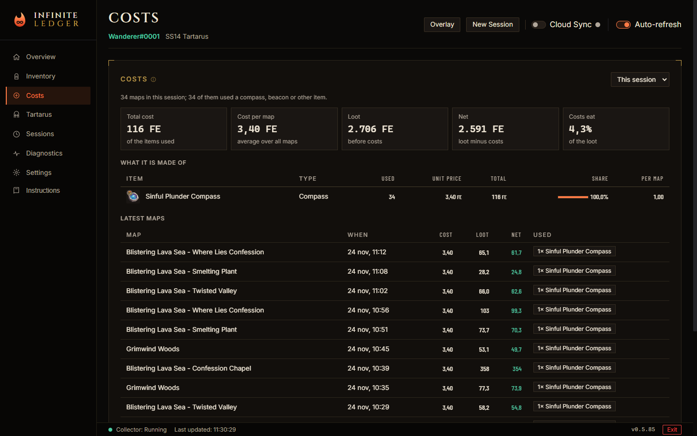

  

<h1 align="center">InfiniteLedger</h1>

  <b>A local loot tracker for Torchlight Infinite.</b> 
  See what every map earns you, what it costs, and what you are worth, without leaving your computer.

  <a href="../../releases/latest"><b>Download the latest version</b></a>
  &nbsp;·&nbsp; Windows 10 / 11

---

## What it does

InfiniteLedger reads the log file the game already writes and turns it into numbers you can use:

- **Per map:** loot, map cost, net profit, run time and pace, compared with your average.
- **Per session:** FE per hour, FE per map, total time, cumulative value and charts.
- **Net worth:** your inventory valued in Flame Elementium (FE), optionally after the 12.5 % trade tax.
- **Map costs:** compasses, beacons and Proofs of the Brave are subtracted from each run, with a breakdown of what you used.
- **Loot report:** every item you picked up, how much it is worth and how big a share of your income it is. You can ignore items or whole runs and export to CSV.
- **Low supply alerts:** a warning when the compasses, beacons or resonances you actually use run low.
- **Overlay:** a transparent always-on-top window (or a one-line micro overlay) with your live stats, which clicks pass through to the game.
- **Tartarus Prison:** tracks your boards, and can show move hints on the board (see below).
- **Real-time tracking, sessions, backups and diagnostics** for the days something looks wrong.

  
  

## Private by design

- **Everything stays on your computer.** There is no account and nothing to sign up for.
- It **only reads the game's log file**. It does not touch the game's memory, inject anything or click for you.
- Sharing prices (Cloud Sync) and sharing anonymous strategy records are **opt-in and off by default**. When you turn them on you can see exactly what is sent, and delete it again.
- The local web server only answers this computer and refuses requests from web pages.

## Install

1. Download **`InfiniteLedger-Setup-x.y.z.exe`** from the [latest release](../../releases/latest).
2. Run it. It installs for your user only (no administrator rights needed).
3. Start the game, **turn on Settings → Enable Log in Torchlight**, and play a map.

The app updates itself from this page: when a new version is out it downloads in the background and installs the next time you close the app (or from Settings → Updates).

> **Windows SmartScreen:** the installer is not code-signed yet, so Windows may warn about an unknown publisher. Choose *More info → Run anyway*.

## Good to know

**"Character not detected."** Torchlight writes your character into the log only when *Enable Log* is on at the moment you log in, and it forgets that setting every time the game restarts. Turn Enable Log on, go back to the character select screen and log in again. If the app has seen your character before, it carries on with that one in the meantime and tells you it is a guess.

**Inventory out of sync.** Open your bag and press the in-game Sort button. The game then writes every slot to the log and the tracker catches up.

**Where is my data?** `%LOCALAPPDATA%\InfiniteLedger` (database, log file and a daily backup of the last 7 days). Settings → Diagnostics shows the state of everything and has a copyable report if you need help.

**Prices.** The app learns prices when you search an item in the in-game Exchange. With Cloud Sync on you also get community prices.

## Tartarus move hints

For the Tartarus Prison minigame, InfiniteLedger can frame the best move over the game window. The solver behind it is the open source [TartarusSolver](https://github.com/glcoder/TartarusSolver) by Artem Gurevich (MIT licence). The hints only read the game window and the log; **nothing is ever clicked or typed for you**. Turn it on or off on the Tartarus page.

## Credits and licences

- [TartarusSolver](https://github.com/glcoder/TartarusSolver), MIT, © 2026 Artem Gurevich.
- Fonts: Inter, Cinzel and Barlow Condensed (SIL Open Font License), shipped with the app.
- Item and zone data from the community database [TLIDB](https://tlidb.com).
- The full list is in `THIRD_PARTY_NOTICES.md` inside the app folder.

InfiniteLedger is a fan-made tool. It is not affiliated with or endorsed by the publisher or developer of Torchlight Infinite. Game names and artwork belong to their owners.

## Feedback

Found a bug or have an idea? [Open an issue](../../issues). Please attach the report from Settings → Diagnostics.
